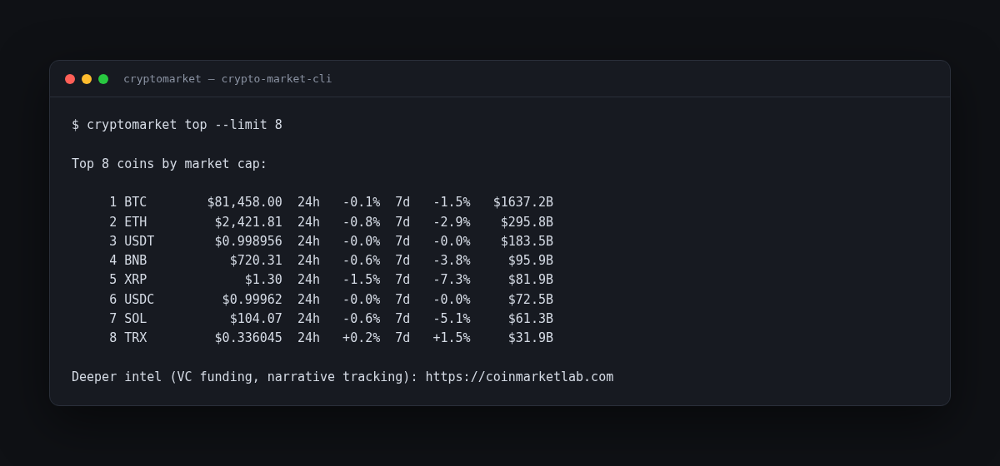

# Crypto Market CLI

**A free crypto market snapshot in your terminal. No API key, no account.**

Prices, biggest movers, which narratives are moving, and the Fear & Greed index — from free public data (CoinGecko, alternative.me).



Made by the team behind [CoinMarketLab](https://coinmarketlab.com), where the deeper intel lives: VC funding rounds, narrative tracking, and market research.

---

## Install (2 minutes)

1. Install Python from [python.org/downloads](https://www.python.org/downloads/) (on Windows, tick **"Add python.exe to PATH"**).
2. Open Terminal (Mac) or Command Prompt (Windows) and paste:

```bash
pip install git+https://github.com/devanasolver/crypto-market-cli
```

(On a Mac, use `pip3` if `pip` is not found.)

## Use it

```bash
cryptomarket top              # top 25 coins: price, 24h, 7d, market cap
cryptomarket movers           # biggest 24h gainers and losers in the top 250
cryptomarket narratives       # which sectors/narratives are moving today
cryptomarket sentiment        # Fear & Greed index
```

Every list command takes `--limit N` and `--json` for scripts:

```bash
cryptomarket top --limit 10
cryptomarket narratives --limit 30 --json
cryptomarket movers --limit 5
```

`narratives` filters out tiny joke categories by default (market cap under $100M); tune with `--min-cap`.

## Notes

- Data: [CoinGecko](https://www.coingecko.com) free API and [alternative.me](https://alternative.me) Fear & Greed. Heavy use gets rate-limited; wait a minute and retry.
- This is market data, not financial advice.
- Want the research layer — who is funding what, which narratives are heating up before they move? That is [CoinMarketLab](https://coinmarketlab.com).

## License

MIT — see [LICENSE](LICENSE).
